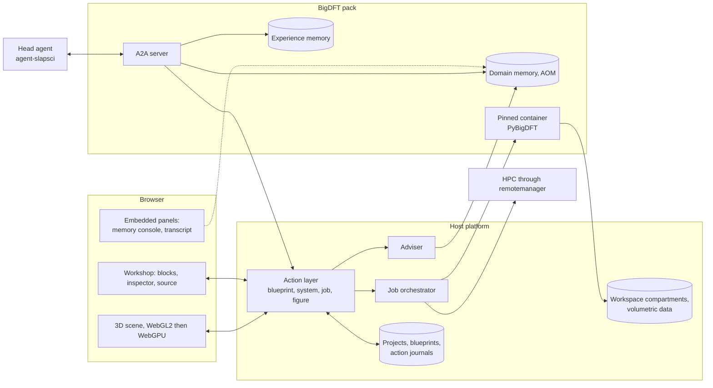

# Ondelette, the matter workshop

Day-one proposal. "Ondelette" (French for wavelet, the basis of BigDFT) is a working name.

Immersive mock-up: <https://claude.ai/artifact/DonwKJb1QPz4ygYwUB5QkY> (shared from its Share menu).
Locally: `python tools/preview.py`, then <http://localhost:8765>.

## 1. The idea on one page

BigDFT can do a great deal and exposes it through 313 input variables. The simplest way to "do everything" is neither a form with 313 fields nor an agent everything is delegated to. It is an **object you build**:

> A simulation is a **blueprint of seven blocks** laid around a 3D scene. Each block answers one question. Each value says where it comes from. Whatever you do with the mouse, the agent can do through the same action, and the other way round.

Three views of the same object stay in sync: the 3D scene, the blocks, and the source (the YAML file BigDFT reads, plus the equivalent PyBigDFT script). You can enter through any of them. A beginner touches the scene and a few controls; an expert writes in the source or searches a variable by name. It is the same workshop.

What makes building enjoyable: the scene reacts to every move (the wavelet grid tightens when `hgrids` goes down, spin switches on when a crystal is doped), a gauge says whether the blueprint is ready, the cost is stated before launch, and someone else's work can be replayed like a saved game.

The object is called a *blueprint*, not a recipe, on purpose: in aom-memory and pack-kit a **recipe** is a consolidated episode of experience, and the two must not be confused.

## 2. What I examined

| Source | What I take from it |
|---|---|
| `bigdft-suite` upstream (GitLab `l_sim`, revision of 2026-09-25) | `input_variables_definition.yaml` of BigDFT, PSolver and CheSS: the code loads these files itself, so they are the source of truth. 313 variables with defaults, bounds, allowed values, activation conditions, and 12 named profiles (`linear`, `mixing`, `water`…). |
| PyBigDFT (`InputActions.py`, `Calculators.py`, `Fragments`, `BioQM`, `PostProcessing`) | About fifty high-level actions (`set_xc`, `optimize_geometry`, `set_implicit_solvent`…). They already are "moves": the mock-up emits real PyBigDFT. |
| Your fork `Yopla38/BigDFT` | Dated 2017. I worked on upstream, which is richer (profiles, solvent, CheSS). |
| `l_sim/ia_tools/pack-kit` (v0.7.0rc8) | What a pack is, how it is served (A2A), how it publishes its interface (panels), how it declares its files and its container. See §7. |
| `l_sim/ia_tools/agent_slapsci` | **Private: I could not read it.** What I say about it comes from pack-kit's docstrings. |
| AOM format 1.0.1 (`hopa_aom/aom_format`) | SQLite file with six tables, facts with mandatory provenance, pivots for n-ary relations, artifacts for verbatim content. See §5. |
| `BigDFT-group/llm-hackathon-2025` (LARA-HPC), OntoFlow | remotemanager, the BigDFT-school notebooks (the guided paths of the mock-up follow them), earlier ontologies. |
| OneAngstrom partner program | SAMSON SDK, SAMSON Connect marketplace, no fixed fee, a percentage of sales, usage-based billing of cloud services called from SAMSON. SAMSON is a desktop application. See §9. |
| V_Sim (`l_sim/v_sim`, 3.9.0 tagged June 2025) | Desktop application. See §9. |
| Paper2Agent (arXiv 2509.06917) | Turns a paper and its code into a tested MCP server. See §7. |
| WEAS, Mol\*, 3Dmol.js | See §8. |

## 3. The seven blocks

| Block | Question | BigDFT sections | Essential controls |
|---|---|---|---|
| **Matter** | What are we talking about? | `posinp` | structure, cell, boundary conditions, fragments, atom editing |
| **Theory** | How are electrons described? | `dft`, `sic`, `mode` | `ixc`, `nspin`, `mpol`, `qcharge`, `dispersion` |
| **Accuracy** | At what numerical price? | `dft`, `mix`, `lin_*`, `chess` | `hgrids`, `rmult`, `gnrm_cv`, cubic or linear scaling |
| **Environment** | What is around it? | `kpt`, `psolver.environment`, `dft.elecfield` | k-points, implicit solvent, field, electronic temperature |
| **Task** | What is asked? | `geopt`, `md`, `tddft` | energy, relaxation, dynamics, path (NEB), excitations, fragments |
| **Observables** | What do we want to see? | `output`, `lin_general` | density, orbitals, DOS, dipole, charges |
| **Machine** | Where, and for how much? | `perf`, `psolver.setup` | target, cores, GPU, budget |

The order is the order in which a physicist states the problem. Boundary conditions live in Matter because they are a property of the cell (`posinp.cell`); their consequences (k-points, field) live in Environment.

## 4. 313 parameters, three depths

Nothing is copied by hand. `tools/extract_schema.py` reads the BigDFT source and writes `schema/bigdft-input.schema.json`. `schema/ui-tiers.yaml` holds only the product decision: for each variable, its block and its depth. Generation fails if a listed variable no longer exists upstream, so a BigDFT upgrade cannot leave an orphan control.

| Depth | Count | Form | Criterion |
|---|---|---|---|
| Essential | 29 | a control drawn on the block | changes the physics or the cost, and a beginner can understand the question |
| Advanced | 68 | an editable row, one click away | regularly useful to a practitioner (mixing, NEB, thermostat, localisation radii) |
| Expert | 216 | full-text search over the whole code | internal numerical settings, debug outputs, experimental options |

What becomes a "button", and why:

- **`hgrids` and `rmult`**: the two settings that make the quality of a wavelet basis. They are *visible*: the scene shows a slice of the two-level grid, and the number of degrees of freedom $N_c + 7N_f$ feeds the memory and time estimate.
- **`ixc`, `nspin`, `mpol`, `qcharge`**: the minimal physics. The aliases of the source (`PBE`, `PBE0`, `B3LYP`…) become the offered choices.
- **`inputpsiid`**: shown as a choice of algorithm (cubic or linear), not as an integer.
- **Profiles** (`linear`, `mixing`, `water`): the code's own presets. The interface calls them with `import`; it does not copy their values.
- **Activation conditions** of the source (`CONDITION / MASTER_KEY`) drive what is shown: `nimg` appears only for NEB, the thermostat only for dynamics.

What does *not* become a button: the 49 `perf` variables (except acceleration and a few analyses), the internal tolerances of CheSS, the block sizes of the input guess. They remain reachable in Expert mode and in the source.

## 5. Defaults that adapt, and say why

Every value carries a provenance: **BigDFT default**, **Adapted**, **You**, **Agent**, **Paper**. An adapted value never overwrites a human choice: when the advice differs it is shown beside the value with a "Follow the advice" button.

In the mock-up a dozen rules are hard-coded to show the behaviour. All are grounded in the code or its documentation:

- odd electron count → collinear spin, moment of the same parity (try it: substitute one Si with P);
- gapless system → `mixing` profile;
- periodic system → k-point mesh from the cell size;
- D3 requested with surface boundary conditions → refused with the reason (PyBigDFT: "only works with Free Boundary conditions");
- electric field along a periodic direction → refused (documentation of `elecfield`);
- biomolecule → implicit water with a soft-sphere cavity, SQNM with `biomode`.

In production these rules are **facts of the pack's memory**, not code. The pack schema already has the right shapes, and I align on them instead of inventing a parallel vocabulary:

| What the interface needs | In the memory |
|---|---|
| "in this kind of case, that parameter takes this value" | a `Prescription` pivot (`onParameter`, `appliesInContext`, `prescribesValue` / `prescribesNumeric`, `justification`) |
| a blocking check versus a comfort recommendation | `isMandatory` on the prescription |
| "this combination fails" | a `Pitfall` (symptom, affected parameter, remedy, silent or loud failure) |
| the "why?" under a value | the triplet, plus the passage in `memories` linked through `triplet_sources` |
| exact facts about a parameter (default, bounds, section, block, depth) | the **workshop layer** below, loaded without an LLM |

Two files implement the last row:

- `ontology/workshop_layer.ttl`: an uninstantiated layer (5 classes, 12 properties) that adds to a pack schema only what the interface needs: section, block, tier, default, bounds, allowed values, activation dependency, profiles. It is descriptive on purpose: advice stays a `Prescription`.
- `ontology/instances/bigdft-parameters.ttl`: the 313 parameters, 20 sections and 12 profiles as instances, generated from the source. It is meant for pack-kit's `ttl_instances` loader, which writes facts without an LLM call. A default of 0.45 paraphrased into "about 0.45 bohr" would be a wrong fact carried silently.

`ontology/corpus/bigdft-variables.md` carries the prose descriptions, one Markdown section per variable, for a `sources.yaml` entry using the `markdown_sections` preprocess. Given the n-ary nature of the advice ("this value, *for* that kind of system"), the pack should use `triplet_mode: nary`.

Both Turtle files parse and cross-reference cleanly (checked with rdflib: no undeclared term, no dangling reference). They have **not** been run through `pack_kit.learn` or `aom_ingest`, which are not installed here.

## 6. The five spaces

1. **Workshop**: build, run, analyse. The heart.
2. **Library**: capsules to replay, papers to rebuild, guided paths.
3. **Lab**: shared projects, comments anchored on an atom or a curve, live presence.
4. **Compute**: execution targets, queue, credits, expertise offers.
5. **Publish**: figure at journal size, methods paragraph and references written from the blueprint, equations in LaTeX.

References will come from `bigdft_bibliography.yaml`, which the code already maintains.

## 7. Where the workshop sits in the existing ecosystem

pack-kit changes the architecture I first sketched, for the better. The workshop should not bring its own agent plumbing. It should be a **host for packs**.

| Existing piece | Role for the workshop |
|---|---|
| **Pack** (prompts, ontology, memory, tools, optional container) | One simulation code is one pack. BigDFT now; GROMACS later is a second pack, not a rewrite. pack-kit's own examples already speak of `.mdp` files. |
| **Head agent**, owned by the user, calling packs with `use_pack` | The "Agent" drawer of the mock-up. It is optional and is never the centre: it is a second user of the same actions. |
| **A2A server** of a pack | The transport. An A2A task in `input-required` (a tool the pack's policy sets to `ask`) is exactly the *Approve / Reject* card of the mock-up. |
| **`declare_file` and `MANIFEST.json`** (path, role, sha256, `derived_from`) | The files of a blueprint (`input.yaml`, `run.py`, structures, figures) are declared, not guessed. `derived_from` gives the "Paper" and "Agent" provenance marks a verifiable origin. |
| **Panels** (`pack_kit.panels`, capability vocabulary) | The workshop embeds what already exists: aom_web's memory console and agent-slapsci's transcript. It maps roles to `read / ingest / curate / purge / configure / optimize` once. |
| **Experience memory** (aom-memory: episodes, judged, consolidated into recipes) | A **capsule** is an episode together with its workspace compartment and the container digest. Judged capsules become recipes, which feed the Library and the advice. |
| **Container block** with a measured digest, launcher plus Landlock-confined agent | The Machine block lists what the pack declares. A capsule records the digest, never a tag. |
| **LLM policy** (a pack never ships a model, the user's choice comes first) | The platform does not impose a model. |

Consequences for the design:

- **One action layer** (`blueprint.set`, `system.edit`, `job.submit`, `figure.render`…) serves the interface, the pack's tools (agent-slapsci `native:` functions) and an MCP server. The agent cannot do anything that is not visible and undoable in the interface.
- **A capsule is a replayable journal** of those actions, human or agent. The slider of the mock-up does exactly that, and one can fork at any step.
- **Paper → blueprint**: the Methods section is mapped onto blocks, each value marked "Paper" with its source passage; what the paper does not say is completed by the adviser and flagged. When a paper ships code, Paper2Agent can turn it into an MCP server added to the head agent's toolbox. The two approaches complement each other.

## 8. Proposed architecture

Structuring choices:

- **Schema first.** Server-side validation models, forms and the parameter graph are generated from the same JSON.
- **Server in Python**, because PyBigDFT is native there (building the input, incremental reading of the YAML logfile for live convergence, post-processing) and so are pack-kit and the AOM bricks.
- **Blueprint state as a shared document** (CRDT), for multi-user editing and for the action journal capsules are made of.
- **3D scene: own engine on three.js.** The mock-up shows it is tenable: instanced atoms and bonds, periodic images, grid slice, isosurfaces computed in the browser. No existing library covers molecules, crystals, surfaces, the wavelet grid and editing together. WEAS (MIT, three.js) is the closest for materials but is a small project. Mol\* is the reference for large biomolecules: I propose to integrate it as a representation engine when the biology side arrives, rather than rewriting ribbons and surfaces.
- **Volumetric data**: `cube` files converted server-side into a multi-resolution pyramid, isosurfaces extracted in a worker.
- **Export**: high-resolution PNG and SVG/PDF from the scene, glTF and POV-Ray for rendering, RO-Crate for data deposit.

## 9. OneAngstrom and V_Sim

**OneAngstrom (SAMSON).** The program offers an SDK, a marketplace, licence and payment handling, and usage-based billing of a cloud service called from SAMSON. SAMSON is a desktop application that already has a GROMACS wizard running calculations in the cloud. My reading: SAMSON is a **distribution channel**, not the foundation of a web site. A "BigDFT" extension in SAMSON would be a thin client of our action layer (same blueprints, same credits), reaching their user base without duplicating the engine. To validate with them: the terms of the fee, whether our accounts can be linked, whether a web component exists.

**V_Sim.** A desktop application maintained by L_Sim that knows BigDFT's formats natively. It cannot be embedded in a page as it is. Three possible uses, to discuss with its maintainer: (a) publication-quality rendering on the server, headless; (b) reuse of its format readers and representation conventions; (c) an "open in V_Sim" link for those who already use it.

## 10. Proposed build order

| Step | Content | Proof |
|---|---|---|
| 0, done | Extracted schema, curation, mock-up, workshop layer and parameter graph | this repository |
| 1 | Action layer, models generated from the schema, pinned PyBigDFT container, live convergence | a real H₂O calculation launched from the page |
| 2 | Production scene: XYZ/PDB/CIF import, editing, `cube` reading, real results | density and orbitals of a real run in the scene |
| 3 | Host a BigDFT pack: adviser reading the memory, head agent over A2A with approvals, panels embedded, capsules recorded and replayed | a capsule replayed end to end |
| 4 | Projects, sharing, anchored comments, presence | two people on the same scene |
| 5 | Credits, estimate calibrated on past runs, HPC through remotemanager, expertise offers | a billed calculation |
| 6 | Publish: vector figures, methods, references, RO-Crate; paper → blueprint | a figure and its paragraph usable as they are |
| 7 | Opening: a GROMACS pack, QM/MM, SAMSON extension | a hybrid blueprint |

## 11. What the mock-up is, and is not

Real in the mock-up: the 313 variables and their tiering, the structures (built by exact geometry), the two-level wavelet grid, the adaptation and checking logic, the generated YAML and PyBigDFT, the bibliographic references.

Simulated: execution (no calculation runs), result values, isosurfaces (superposition of toy orbitals, marked "illustration"), times and costs (uncalibrated orders of magnitude), prices, people and example projects. The agent knows three moves.

Verified: renders without error in Chromium, light and dark themes, desktop and phone widths; substitution → spin, paper → blueprint, capsule, run, agent approval and publish flows. Not verified: Safari and Firefox; the per-element localisation radii (approximate values); the generated `input.yaml` has not been fed to a real BigDFT.

## 12. Questions to move forward

1. **Existing platform.** pack-kit says it was extracted from a platform monorepo (FastAPI backend, React frontend, a runner with sidecars). Is the workshop to be built inside that platform, or beside it as a second host?
2. **Existing BigDFT pack.** pack-kit's code mentions one. Should the workshop layer be merged into its schema, and may I read it and `agent_slapsci`?
3. **Capsule format.** Is a capsule an aom-memory episode plus its workspace, as I assume in §7, or is there another serialisation to respect?
4. **Compute at launch.** A single container, or a specific cluster from the start? Which image digest is the reference?
5. **First audience.** Teaching, materials researchers, or biology? This sets the order of steps 2 to 4.
6. **Openness.** The repository is MIT-licensed. Will the platform be open, or only parts of it?
7. **OneAngstrom and L_Sim.** Do you already have contacts? Two draft letters are in `docs/letters/`.
