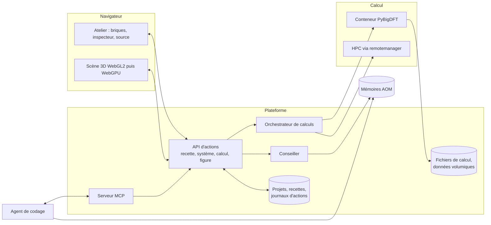

# Ondelette, atelier de la matière

Proposition du premier jour. « Ondelette » est un nom de travail (la base de BigDFT), à changer librement.

Maquette immersive : <https://claude.ai/artifact/DonwKJb1QPz4ygYwUB5QkY> (privée, à partager depuis son menu).
En local : `python tools/preview.py`, puis <http://localhost:8765>.

## 1. L'idée en une page

BigDFT sait faire beaucoup de choses et les expose par 313 variables d'entrée. La façon la plus simple de « tout faire » n'est pas un formulaire de 313 champs, ni un agent à qui l'on délègue tout. C'est un **objet que l'on construit** :

> Une simulation est une **recette de sept briques** posées autour d'une scène 3D. Chaque brique répond à une question. Chaque valeur dit d'où elle vient. Tout ce que l'on fait à la souris, l'agent peut le faire par la même action, et réciproquement.

Trois vues du même objet restent synchronisées en permanence : la scène 3D, les briques, et la source (le fichier YAML que BigDFT lit, plus le script PyBigDFT équivalent). On peut entrer par n'importe laquelle. Un débutant ne touche que la scène et quelques contrôles, un expert écrit directement dans la source ou cherche une variable par son nom. C'est le même atelier.

Ce qui donne le plaisir de construire : la scène réagit à chaque geste (la grille d'ondelettes se resserre quand on baisse `hgrids`, le spin s'active quand on dope un cristal), une jauge dit si la recette est prête, le coût est annoncé avant de lancer, et l'on peut rejouer le travail de quelqu'un d'autre comme une partie sauvegardée.

## 2. Ce que j'ai examiné

| Source | Ce que j'en tire |
|---|---|
| `bigdft-suite` amont (GitLab `l_sim`, révision du 25/09/2026) | `input_variables_definition.yaml` de BigDFT, PSolver et CheSS : le code charge lui-même ces fichiers, ils sont la source de vérité. 313 variables, avec défauts, bornes, valeurs admises, conditions d'activation et 12 profils nommés (`linear`, `mixing`, `water`…). |
| PyBigDFT (`InputActions.py`, `Calculators.py`, `Fragments`, `BioQM`, `PostProcessing`) | Une cinquantaine d'actions de haut niveau (`set_xc`, `optimize_geometry`, `set_implicit_solvent`…). Ce sont déjà des « gestes » : la maquette génère du PyBigDFT réel. |
| Votre fork `Yopla38/BigDFT` | Daté de 2017. J'ai travaillé sur l'amont, plus riche (profils, solvant, CheSS). |
| `BigDFT-group/llm-hackathon-2025` (LARA-HPC), OntoFlow | Agent, remotemanager, carnets BigDFT-school, ontologies existantes. Les parcours guidés de la maquette reprennent ces carnets. |
| Format AOM 1.0.1 (`hopa_aom/aom_format`) | Base SQLite à six tables, faits `(sujet, prédicat, objet)` avec provenance obligatoire, pivots pour les relations n-aires, artefacts pour le contenu verbatim. Voir §5. |
| Programme partenaire OneAngstrom | SDK SAMSON, place de marché SAMSON Connect, pas de frais fixes, commission sur les ventes, facturation à l'usage de services cloud appelés depuis SAMSON. SAMSON est une application de bureau. Voir §9. |
| V_Sim (`l_sim/v_sim`, 3.9.0 en juin 2025) | Application de bureau. Voir §9. |
| Paper2Agent (arXiv 2509.06917) | Transforme un article et son code en serveur MCP testé. Voir §7. |
| WEAS, Mol\*, 3Dmol.js | Voir §8. |

## 3. Les sept briques

| Brique | Question | Sections BigDFT | Contrôles essentiels |
|---|---|---|---|
| **Matière** | De quoi parle-t-on ? | `posinp` | structure, cellule, conditions aux limites, fragments, édition d'atomes |
| **Théorie** | Comment décrit-on les électrons ? | `dft`, `sic`, `mode` | `ixc`, `nspin`, `mpol`, `qcharge`, `dispersion` |
| **Précision** | À quel prix numérique ? | `dft`, `mix`, `lin_*`, `chess` | `hgrids`, `rmult`, `gnrm_cv`, cubique ou linéaire |
| **Milieu** | Qu'y a-t-il autour ? | `kpt`, `psolver.environment`, `dft.elecfield` | points k, solvant implicite, champ, température électronique |
| **Action** | Que demande-t-on ? | `geopt`, `md`, `tddft` | énergie, relaxation, dynamique, chemin (NEB), excitations, fragments |
| **Mesures** | Que veut-on voir ? | `output`, `lin_general` | densité, orbitales, DOS, dipôle, charges |
| **Machine** | Où, et pour combien ? | `perf`, `psolver.setup` | cible, cœurs, GPU, budget |

L'ordre est celui dans lequel un physicien pose le problème. Les conditions aux limites vivent dans Matière parce qu'elles sont une propriété de la cellule (`posinp.cell`), et leurs conséquences (points k, champ) dans Milieu.

## 4. 313 paramètres, trois profondeurs

Rien n'est copié à la main. `tools/extract_schema.py` lit la source de BigDFT et produit `schema/bigdft-input.schema.json`. `schema/ui-tiers.yaml` ne contient que la décision produit : pour chaque variable, sa brique et sa profondeur. La génération échoue si une variable citée n'existe plus en amont : une montée de version de BigDFT ne peut pas laisser un contrôle orphelin.

| Profondeur | Nombre | Forme | Critère |
|---|---|---|---|
| Essentiel | 29 | un contrôle dessiné sur la brique | change la physique ou le coût du calcul, et un débutant peut comprendre la question |
| Avancé | 68 | une ligne éditable, à un clic | utile régulièrement à un praticien (mélange, NEB, thermostat, rayons de localisation) |
| Expert | 216 | recherche plein texte sur tout le code | réglages numériques internes, sorties de débogage, options expérimentales |

Ce qui devient un « bouton » et pourquoi :

- **`hgrids` et `rmult`** : les deux réglages qui font la qualité d'une base d'ondelettes. Ils sont *visibles* : la scène montre la coupe de la grille à deux niveaux, et le nombre de degrés de liberté $N_c + 7N_f$ alimente l'estimation de mémoire et de durée.
- **`ixc`, `nspin`, `mpol`, `qcharge`** : la physique minimale. Les alias de la source (`PBE`, `PBE0`, `B3LYP`…) deviennent les choix proposés.
- **`inputpsiid`** : présenté comme un choix d'algorithme (cubique ou linéaire), pas comme un entier.
- **Les profils** (`linear`, `mixing`, `water`) : ce sont les préréglages officiels du code. L'interface les appelle par `import`, elle ne recopie pas leurs valeurs.
- **Les conditions d'activation** de la source (`CONDITION / MASTER_KEY`) pilotent l'affichage : `nimg` n'apparaît que pour NEB, le thermostat que pour la dynamique.

Ce qui ne devient *pas* un bouton : les 49 variables `perf` (sauf accélération et quelques analyses), les tolérances internes de CheSS, les tailles de blocs de l'input guess. Elles restent atteignables en mode Expert et dans la source.

## 5. Des valeurs par défaut qui s'adaptent, et qui disent pourquoi

Chaque valeur porte une provenance : **Défaut BigDFT**, **Adapté**, **Vous**, **Compagnon**, **Article**. Une valeur adaptée n'écrase jamais un choix humain : si le conseil diffère, il s'affiche à côté avec un bouton « Suivre le conseil ».

Dans la maquette, une douzaine de règles sont écrites en dur pour montrer le comportement. Exemples, tous fondés sur le code ou sa documentation :

- nombre impair d'électrons → spin colinéaire, moment de même parité (essayez : substituer un Si par un P) ;
- système sans gap → profil `mixing` ;
- système périodique → grille de points k selon la taille de la maille ;
- D3 demandé en conditions de surface → refus motivé (PyBigDFT : « only works with Free Boundary conditions ») ;
- champ électrique dans une direction périodique → refus (documentation de `elecfield`) ;
- biomolécule → eau implicite soft-sphere, SQNM avec `biomode`.

En production, ces règles sont des **faits d'une mémoire AOM**, pas du code. Le format 1.0.1 s'y prête exactement :

| Besoin de l'interface | Dans la base AOM |
|---|---|
| « pour tel trait de système, tel paramètre prend telle valeur » | nœud **pivot** `at:Recommandation` avec ses rôles (`concerne`, `siSysteme`, `valeurConseillee`, `justification`) |
| le « pourquoi ? » affiché sous la valeur | le triplet, plus le passage de `memories` relié par `triplet_sources` (texte et source) |
| une action PyBigDFT ou une étape de capsule | nœud **artefact** : le code est stocké verbatim dans `artifacts` |
| comparer des valeurs numériques | littéraux canoniques typés (`xsd:double`, `xsd:integer`) |

`ontology/atelier.ttl` est l'ontologie non instanciée correspondante (17 classes, 31 propriétés, autoportante). `ontology/corpus/bigdft-variables.md` est un corpus généré : un passage par variable et par profil, prêt pour `aom_ingest`. Je propose trois mémoires distinctes, parce qu'elles n'ont ni le même rythme ni la même autorité :

1. **Paramètres** (générée depuis la source, régénérée à chaque version de BigDFT) ;
2. **Savoir-faire** (recommandations et contraintes, tirées de la documentation, des carnets et des experts, relues) ;
3. **Capsules** (ce qui a été fait, avec son coût mesuré, pour recommander par analogie et calibrer les estimations).

## 6. Les cinq espaces

1. **Atelier** : construire, lancer, analyser. Le cœur.
2. **Bibliothèque** : capsules à revivre, articles à reconstruire, parcours guidés.
3. **Laboratoire** : projets partagés, commentaires ancrés sur un atome ou une courbe, présence en direct.
4. **Calcul** : cibles d'exécution, file d'attente, crédits, offres d'expertise.
5. **Publication** : figure à la taille de la revue, paragraphe de méthodes et références écrits depuis la recette, équations en LaTeX.

Les références viendront de `bigdft_bibliography.yaml`, que le code maintient déjà.

## 7. L'agent, les capsules, les articles

**L'agent n'est pas le centre de gravité.** Il est un second utilisateur de la même API. Une seule couche d'actions (`recipe.set`, `system.edit`, `job.submit`, `figure.render`…) sert l'interface, le serveur MCP et un SDK Python. Conséquences : l'agent ne peut rien faire qui ne soit visible et annulable dans l'interface, chacune de ses propositions est un *diff de recette* que l'on accepte ou non, et les valeurs qu'il pose portent sa marque.

Outils MCP à exposer (en plus de `aom_query`) : `system.load / build / edit`, `recipe.get / set / validate / explain`, `recipe.compile`, `job.estimate / submit / status / cancel`, `result.get`, `figure.render`, `capsule.record / replay / fork`, `paper.extract`.

**Capsule** : la suite ordonnée des actions (humaines ou de l'agent), les fichiers, et l'environnement figé (empreinte de l'image du conteneur, versions). Comme toute action passe par la même API, rejouer une capsule revient à rejouer son journal. Le curseur de la maquette fait exactement cela. On bifurque à n'importe quelle étape.

**Article → recette** : extraction de la section Méthodes vers les briques, chaque valeur marquée « Article » avec le passage source. Ce que l'article ne dit pas est complété par le conseiller et signalé comme tel. Si l'article fournit du code, Paper2Agent peut en faire un serveur MCP ajouté à la boîte à outils de l'agent : les deux approches se complètent.

## 8. Architecture proposée

Choix structurants :

- **Schéma d'abord.** Les modèles de validation du serveur, les formulaires et la mémoire « Paramètres » sont générés depuis le même JSON.
- **Serveur en Python**, parce que PyBigDFT y est natif (construction de l'entrée, lecture incrémentale du logfile YAML pour la convergence en direct, post-traitement).
- **État de la recette en document partagé** (CRDT), pour l'édition à plusieurs et le journal d'actions qui fait les capsules.
- **Scène 3D : moteur propre sur three.js.** La maquette montre que c'est tenable : atomes et liaisons instanciés, images périodiques, coupe de grille, isosurfaces calculées dans le navigateur. Aucune bibliothèque existante ne couvre à la fois molécules, cristaux, surfaces, grille d'ondelettes et édition. WEAS (MIT, three.js) est la plus proche pour les matériaux mais reste un petit projet. Mol\* est la référence pour les grandes biomolécules : je propose de l'intégrer comme moteur de représentation quand le volet biologie arrive, plutôt que de réécrire rubans et surfaces.
- **Données volumiques** : conversion des `cube` côté serveur en pyramide multi-résolution, isosurfaces extraites dans un worker.
- **Export** : PNG haute résolution et SVG/PDF depuis la scène, glTF et POV-Ray pour le rendu, RO-Crate pour le dépôt de données.

## 9. OneAngstrom et V_Sim

**OneAngstrom (SAMSON).** Le programme offre un SDK, une place de marché, la gestion des licences et des paiements, et la possibilité de facturer à l'usage un service cloud appelé depuis SAMSON. SAMSON est une application de bureau avec déjà un assistant GROMACS qui lance des calculs dans le cloud. Ma lecture : SAMSON est un **canal de distribution**, pas le socle d'un site web. Une extension « BigDFT » dans SAMSON serait un client léger de notre API de calcul (mêmes recettes, mêmes crédits), ce qui donne accès à leur base d'utilisateurs sans dupliquer le moteur. À valider avec eux : conditions de la commission, possibilité d'identifier nos comptes, existence d'un composant web.

**V_Sim.** Application de bureau maintenue par L_Sim, qui connaît nativement les formats de BigDFT. Elle ne s'embarque pas telle quelle dans une page. Trois usages possibles, à discuter avec son mainteneur : (a) rendu de qualité publication côté serveur, sans affichage ; (b) réutilisation de ses lecteurs de formats et de ses conventions de représentation ; (c) lien « ouvrir dans V_Sim » pour ceux qui l'utilisent déjà.

## 10. Ordre de construction proposé

| Étape | Contenu | Preuve |
|---|---|---|
| 0, fait | Schéma extrait, curation, maquette, ontologie et corpus | ce dépôt |
| 1 | API d'actions, modèles générés depuis le schéma, conteneur PyBigDFT, convergence en direct | un vrai calcul de H₂O lancé depuis la page |
| 2 | Scène de production : import XYZ/PDB/CIF, édition, lecture de `cube`, résultats réels | densité et orbitales d'un calcul réel dans la scène |
| 3 | Mémoires AOM branchées sur le conseiller, serveur MCP, enregistrement et relecture de capsules | une capsule rejouée bout à bout |
| 4 | Projets, partage, commentaires ancrés, présence | deux personnes sur la même scène |
| 5 | Crédits, estimation calibrée sur les calculs passés, HPC par remotemanager, offres d'expertise | un calcul facturé |
| 6 | Publication : figures vectorielles, méthodes, références, RO-Crate ; article → recette | une figure et son paragraphe acceptables tels quels |
| 7 | Ouverture : GROMACS, QM/MM, extension SAMSON | une recette hybride |

## 11. Ce que la maquette est, et n'est pas

Réel dans la maquette : les 313 variables et leur classement, les structures (construites par géométrie exacte), la grille d'ondelettes à deux niveaux, la logique d'adaptation et de contrôle, le YAML et le PyBigDFT générés, les références bibliographiques.

Simulé : l'exécution (aucun calcul ne tourne), les valeurs de résultats, les isosurfaces (superposition d'orbitales jouets, marquées « illustration »), les durées et coûts (ordre de grandeur non calibré), les tarifs, les personnes et les projets d'exemple. Le compagnon ne connaît que trois gestes.

Vérifié : rendu sans erreur dans Chromium en thèmes clair et sombre, largeur bureau et téléphone ; parcours substitution → spin, article → recette, capsule, lancement, publication. Non vérifié : Safari et Firefox, les rayons de localisation par élément (valeurs approchées), `input.yaml` généré non passé à un BigDFT réel.

## 12. Questions pour avancer

1. **Agent existant** : par quel protocole lui parle-t-on, où tourne-t-il, quels outils MCP a-t-il déjà ? Existe-t-il un format de capsule que je dois respecter ?
2. **Calcul au lancement** : conteneur seul, ou un cluster précis dès le début ? Quelle image BigDFT de référence ?
3. **Premier public** : enseignement, chercheurs en matériaux, ou biologie ? Cela fixe l'ordre des étapes 2 à 4.
4. **Langue** : interface bilingue français et anglais dès le départ ?
5. **Ouverture** : le dépôt est sous licence MIT. La plateforme sera-t-elle ouverte, ou seulement certaines parties ?
6. **OneAngstrom et L_Sim** : avez-vous déjà un contact ? Deux brouillons de courrier sont dans `docs/courriers/`.
